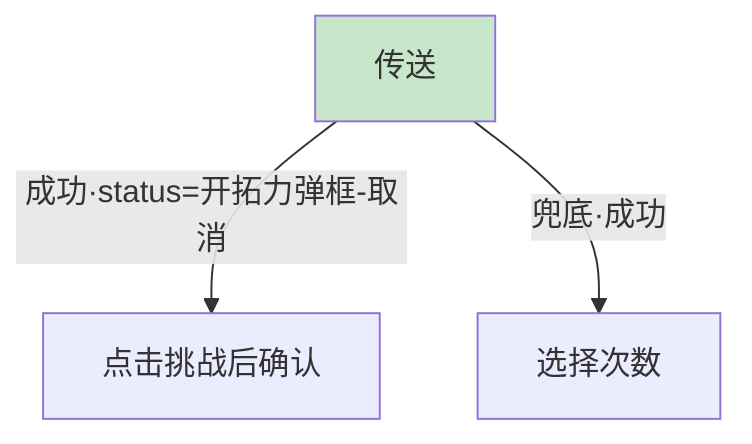

# operation 流转打印工具（describe_operation_flow）迭代设计（总纲）

## 0. 元信息

- 迭代目标：用户需求「增加一个基础 MCP 工具，打印一个 operation 的流转，防止代码写得乱、看不清 node 之间的流转」（2026-11-13 会话直接需求）
- 状态：草案
- 文档清单：（单文档方案，无详设——本文即完整设计）

## 1. 问题与动机

### 1.1 现状症状

- Operation 的节点编排靠 `@operation_node`（挂 `OperationNode` 到函数属性 `operation_node_annotation`）+ `@node_from`（挂 `OperationEdgeDesc` 列表到函数属性 `operation_edge_annotation`）分散声明（`src/one_dragon/base/operation/operation_node.py` / `operation_edge.py`）。节点一多（如 `use_trailblaze_power.py` 15 节点 20 边、`challenge_ehco_of_war.py` 23 边），流转关系只能脑内拼图。
- 编排错误全部推迟到**运行期**才发现：`_analyse_node_annotations` 在 op 运行（`execute` 触发节点网络构建）时才校验「找不到节点 / 多个起始节点 / 找不到起始节点」并 raise（`operation.py` L255-L315）——写错一个 `from_name` 要等到跑起来才炸。
- 远程 MCP 使用者（LLM agent）只有 `list_operations` / `describe_operation`（参数 schema），**看不到节点结构**——op 的过程语义（怎么流转、失败走哪、收尾在哪）对它完全不可见。

### 1.2 根因归层

**表示层**：节点流转信息客观存在于装饰器注解中，但没有任何可读的静态表示形式；错误校验只有运行时一条路径。不是流程层（注解机制本身健康）、不是语义层（边语义明确）。

### 1.3 解决到哪；明确不解决

- 解决：
  1. 新 MCP 工具 `describe_operation_flow(op_id, mermaid=False)`：静态（纯反射、不实例化）提取任意 Operation 子类的节点图，返回文本流转图 + 结构化 nodes/edges + 静态诊断；
  2. 静态诊断覆盖运行时校验（断名边 / 多起点 / 零起点 / 重复节点名），并补运行时不查的结构问题（不可达节点、同方向多条兜底边、边挂在非节点方法上）；「提前发现」由**全量回归测试制度化**（§2.7 第 5 条：扫描根内全部 op 诊断零 error，随测试套常跑），按需调用的工具只承担「随时可看」；
  3. HTTP 镜像端点（与 MCP 同契约单源）。
- 明确不解决：
  - 不改 `one_dragon` 公共框架（不动 Operation / 装饰器 / 运行时校验逻辑——公共包改动需跨项目同步，本需求在 SR 侧只读注解即可满足）；
  - 不做运行时流转 tracing（运行路径已有 `send_node_notify` / 日志 / `get_run_status`，不重复）；不做图形渲染**引擎**（mermaid 源码输出即止，渲染交给客户端）；
  - 不推断 `need_check_game_win`（静态无法可靠判定——子类 super 调用传字面量的场景会误判，见 §2.5）。

## 2. 方案（单文档完整设计）

### 2.1 系统级变化

| 位置 | 变化 |
|---|---|
| `src/sr_od/backend/operation_flow.py` | 新模块：静态提取 + 诊断 + 文本图渲染（核心逻辑单源） |
| `src/sr_od/backend/mcp/service_app.py` | 新增 `make_describe_operation_flow` 工厂 |
| `src/sr_od/backend/mcp/app.py` | 注册 tool（`readOnlyHint=True`） |
| `src/sr_od/backend/http/service_routes.py` | 新增 `GET /game/operations/flow?op_id=`（薄适配，调同一核心函数） |
| `docs/develop/sr_od/backend/mcp.md` / `http.md` | 正本工具表补行（收尾阶段） |
| `sr-od-test/test/sr_od/backend/test_operation_flow.py` | 测试（镜像规范） |

### 2.2 核心提取：类级静态扫描（语义镜像运行时）

**依据**：`Operation._analyse_node_annotations`（`operation.py` L220-L272）遍历 `inspect.getmembers(self, predicate=inspect.ismethod)` 读函数属性；注解挂在**函数对象**上（装饰器 `setattr(func, ...)`），类级遍历同样读得到（MRO 继承、子类重写覆盖行为与运行时一致：重写未再装饰 → 节点消失）。类级遍历的谓词定死为：`inspect.getmembers(cls, predicate=lambda m: inspect.isfunction(m) or inspect.ismethod(m))`——类上取值普通方法为函数（isfunction）、classmethod 为绑定方法（ismethod），两者运行时实例遍历（ismethod）都收；staticmethod 依 `inspect.getattr_static(cls, name)` 返回 `staticmethod` 对象剔除（运行时实例遍历不收 staticmethod，镜像其口径）。

提取规则（逐条镜像运行时语义；术语：**断名边** = `from_name` 匹配不到任何节点的边；**兜底边** = `ignore_status` 归一后为 True 的边）：

1. **节点**：函数带 `operation_node_annotation` → 节点，`cn` 取注解的 `cn`（业务代码内可能用中文或英文 name，不做假设）；同一方法可同时带边注解。**重复节点名**：不同方法同 `cn` → 诊断 `duplicate_node_name`（运行时 `_add_node` L359 raise）；同名节点在 `nodes[]` 全部保留、靠 `method` 字段区分，**边解析的节点匹配镜像运行时 `node_name_map` 的字母序后写覆盖**（L240：字母序遍历中同名后者覆盖前者，静态按同一遍历序构建映射即得同结果）。
2. **边**：函数带 `operation_edge_annotation`（`OperationEdgeDesc` 列表）→ 每条 desc 一条边；**to 节点 = 该边注解所在方法自己的节点**（恒可解析——运行时 `edge.node_to_name` 也是这么填充的，L252；静态不读 `node_to_name` 字段，它可能被历史运行实例污染）。断名边的悬空字段是 **from**：`edges[]` 中 `from=None`。
3. **from 节点**：按 `desc.node_from_name` 匹配节点映射（同名归属见第 1 条）；匹配不到 = 诊断 `missing_node`（运行时 L258 同样 raise）。
4. **边属性**：`success` / `status` 直接读 desc 字段；**`ignore_status` 必须静态归一**——`OperationEdgeDesc.__init__` 是裸赋值（operation_edge.py L61），归一发生在运行时 `OperationEdge.__init__`（L36：`False if status is not None else ignore_status`）；且 `node_from` 装饰器的 `ignore_status` 默认 True，读原值会把所有 status 边误标兜底、令 `duplicate_fallback_edge` 对健康 op 误报。静态归一 = 镜像 `OperationEdge` 构造语义：`ignore_status = False if status is not None else desc.ignore_status`。
5. **起点判定**（镜像 L242-L315）：显式 `is_start_node=True` 优先——**同名双显式起点不报 `multiple_start`**（运行时 L243 `start_node.cn != node.cn` 条件放过，最终由重复名校验兜住）；不同名显式多起点 → `multiple_start`。无显式起点时按**业务边入度 0** 自动判定（入度不含断名边——它没有 from 节点，不构成可达路径；运行时该场景先炸 `missing_node`，静态口径只需自洽不误导）；自动判定出多个 → `multiple_start`；零起点 → `no_start`。**零节点类豁免**：类没有任何节点注解时不做起点判定、零诊断、`start_node=None`——零节点中间基类（如 `CwOperation`，被扫描清单收录但从不单独运行，节点由子类提供）空图上 `no_start` 是噪音而非编排错误，且会让全量回归基线（§2.7 第 5 条）永远红。
6. **遍历序**：`getmembers` 按名称字母序 + 方法内装饰器自下而上追加序——与运行时 edge_list 构建序一致，用于 §2.4.4 兜底边诊断判定「哪条生效」。

### 2.3 工具契约

```
describe_operation_flow(op_id: str, mermaid: bool = False) -> dict
```

- `op_id` 契约与 `describe_operation` 完全同构：完整 `<module>.<ClassName>`（`resolve_op_class` 实时解析，**接受任意 Operation 子类，含 Application**——app 类同样是节点编排重灾区，如 `currency_war_app`；运行类工具 `_is_runnable_op` 排除 Application 是「可运行性」口径，本工具是「可读性」口径，不排斥）或类名短名（扫描缓存精确匹配——App 类虽在扫描根 `_SCAN_ROOTS`（含 `sr_od.application`）内被扫到，但被 `_is_runnable_op` 过滤不进缓存条目，短名查不到属预期；短名未找到/多命中直接复用 `_short_name_not_found_error` / 多命中候选列表，不自造报错文案）。ambiguous 形态**刻意**比 `describe_operation` 的轻（只列候选 op_id 不带参数 schema）：该场景调用方只需要选对目标再看图，带 schema 纯膨胀。
- `mermaid=True` 时额外返回 `mermaid` 字段（mermaid flowchart 源码，渲染规则见 §2.4），默认 False 不占返回体。
- 解析失败（未找到 / 非 Operation 子类）→ MCP 层 except 返回 `{error}`，与 `describe_operation` 同模式；不引入 `success` 键（观察类工具既有惯例）。

返回结构：

```python
{
  'op_id': str, 'class_name': str, 'module': str,
  'start_node': str | None,        # multiple_start/no_start 时 None
  'node_count': int, 'edge_count': int,
  'flow': str,                     # 文本流转图（§2.4.2 格式，主形态）
  'mermaid': str | None,           # mermaid=True 时为 flowchart 源码，否则 None
  'nodes': [                       # BFS 序（§2.4.1），不可达节点垫底
    {'cn': str, 'method': str,           # 方法名，定位源码用
     'is_start_node': bool, 'timeout_seconds': float|None,
     'node_max_retry_times': int, 'reachable': bool},
  ],
  'edges': [                       # from 节点 BFS 序 × 节点内构建序（§2.2 第 6 条）；断名边（from 悬空）统一垫底
    {'from': str|None, 'to': str,        # from=None = 断名边（missing_node）；to 恒可解析（§2.2 第 2 条）
     'success': bool, 'status': str|None, 'ignore_status': bool},  # ignore_status 已静态归一（§2.2 第 4 条）
  ],
  'diagnostics': [
    {'level': 'error'|'warn', 'code': str, 'message': str},  # code 枚举见 §2.4
  ],
  'notes': [str, ...],             # 固定说明（终点语义 / 框架前缀省略等）
}
```

- `diagnostics` 出现 error 时 `flow` 仍尽力渲染（断名边画成 `→ ✗节点不存在`）——调试价值在「运行前看到全貌」，不是报错即止。
- tool docstring 按 MCP 惯例写全（观察类 / 纯反射不实例化 / 为什么不实例化：`SrOperation.__init__` 构造 `OpenAndEnterGame` 等副作用依赖）。

### 2.4 显示格式与诊断项

#### 2.4.1 排序规则（可读性的根）

**节点按执行序排，不按字母序**：`getmembers` 字母序是运行时实现细节，对阅读毫无意义（中文节点名按码点排序后执行叙事全乱）。定义 **BFS 序**：从全部起点（显式起点，无显式则全部入度 0 节点；多起点按字母序依次入队）做广度优先遍历，节点按首次发现序输出（邻接按出边构建序）；**断名边不参与 BFS**（它没有 from 节点，不构成路径）；起点缺失（`no_start`）时退化为字母序全列；不可达节点统一垫底（字母序）；`edges[]` 中断名边统一垫在末尾。`flow` 与 `nodes[]`/`edges[]` 用同一序——三个视图序一致，交叉对照不迷路。BFS 序天然把主干放前、分支靠后、孤岛垫底，贴近阅读直觉。

#### 2.4.2 文本流转图（`flow`，主形态）

按节点分组、边行缩进挂靠；头部两行固定（摘要行 + 图例行——图例与图不分离，记号自解释）。示例为**示意结构**（类名与拓扑非任何真实 op，真实规模数字见 §1.1）：

```
# UseTrailblazePower (sr_od...use_trailblaze_power.UseTrailblazePower) · 12节点 24边 · 起点=传送
# 图例: (成功/失败)=按节点返回结果分流 · status=仅该返回状态走此边 · 兜底=该方向其余状态的落点
[起点] 传送 (method=transport)
  ├─(成功·status=开拓力弹框-取消)→ 点击挑战后确认
  └─(兜底·成功)→ 选择次数
点击挑战后确认 (method=confirm_click) ←入: 传送, 点击挑战, 战斗结果处理 ←✗不存在的来源「阵亡传送恢复」(失败)
  ├─(成功)→ 选择配队
  └─(失败·status=无对话框)→ 选择配队
选择次数 (method=choose_times) [终点]
```

- **边标注**：方向段 `(成功)` / `(失败)`；修饰段二选一——`·status=<值>`（status 非空时）或 `·兜底`（归一后 `ignore_status=True` 时，此时 status 恒 None，二者互斥）；形态如 `(兜底·成功)` / `(成功·status=xxx)`。
- **节点标注**：起点 `[起点]`；无出边 `[终点]`；不可达 `[不可达]`（垫底区）。
- **入边来源标注 `←入:`**：入边 ≥2 的节点在头部行尾列出全部来源节点名（去重）——多入口汇聚点是最容易乱的地方，反向追踪不用全文搜；单入边不标（顺着上一块自然可见）。断名边**不进 `←入:` 计数**，单独以 `←✗不存在的来源「from名」(条件)` 呈现在同一位置——断名边挂在 **to 节点**侧（它没有 from 块可挂靠，且事故语义是「这个节点的某条入路断了」）。
- **终点语义**一次进 `notes`（「无出边节点：返回成功即整个 op 成功、返回失败即整个 op 失败」），不在每个终点节点上重复。
- 环（A→B→A）在分组图里天然表达为两条边行；可达性判定用 BFS（断名边跳过）。

#### 2.4.3 mermaid 渲染（`mermaid=True` 时）

与文本图同数据源第二渲染——分组文本强在逐节点精读，mermaid 强在分支/汇聚/环的全局形貌（可渲染的客户端里一眼看形），互补不互斥。规则：

- 节点 id 用 `n1/n2/…`（BFS 序），label 引号包裹节点 cn；**label 内 `"` 替换为全角 `＂`**（mermaid 字符串内双引号无转义语法）；断名边画幽灵来源虚拟节点 `✗「from名」` 并标红。
- 边标注与文本图同款记号（`成功·status=xxx·兜底`）放 `-->|"标注"|`——**整体引号包裹**，标注内 `"` 同样替换全角（`|` 在引号内不破坏语法）。
- classDef 三类：起点绿色、不可达红色虚线、断名幽灵节点红色；边按 BFS 序输出（渲染序即执行序）。



#### 2.4.4 诊断项

诊断项（`code` 稳定枚举，level 语义：error = 运行时必炸或图不成立；warn = 结构可疑但不致命）：

| code | level | 判定 | 运行时行为对照 |
|---|---|---|---|
| `missing_node` | error | 边的 `from_name` 匹配不到任何节点 | 运行时 raise `找不到节点`（L258） |
| `duplicate_node_name` | error | 不同方法产出同 `cn` 节点 | 运行时 `_add_node` raise（L359） |
| `multiple_start` | error | **不同名**显式多起点，或自动判定多个入度 0 节点（同名双显式起点不报——运行时 L243 同样放过，归 `duplicate_node_name`） | 运行时 raise（L244/L311） |
| `no_start` | error | 无显式起点且无入度 0 节点 | 运行时 raise（L315） |
| `unreachable_node` | warn | 从全部起点 BFS 不可达；**`no_start` 时不逐节点报**（一个 error 已说明全图不可达，逐节点 warn 是刷屏噪音），`nodes[].reachable` 全 false 表达 | 运行时静默——节点永不执行，改漏 `node_from` 的典型症状 |
| `duplicate_fallback_edge` | warn | 同 `(from, success 方向)` 下归一后 `ignore_status=True` 的边 >1 条 | 运行时静默；**双模生效语义**（见下）——message 必须双模陈述，不写单模结论；目标相同的冗余兜底边注明「目标相同无路径丢失」 |
| `edge_on_non_node` | warn | 边注解挂在未被 `@operation_node` 装饰的方法上 | 运行时静默——`_analyse_node_annotations` 对无节点注解的方法 `continue`，边被丢弃（L236-L238） |

**兜底边生效的双模语义依据**（`_get_next_node` L567-L588，归一化保证兜底边 `status` 恒 None）：当前轮返回**不带** status（业务主路径，如空参 `round_success()`）→ L574-L576 首条同方向兜底边 break 生效；当前轮返回**带** status 且无精确匹配 → L585-L586 落兜底，此模下后遍历者覆盖先遍历者（L571-L572 的 final 赋值被同向兜底边持续覆盖）。故诊断 message 措辞：「同方向存在 N 条兜底边：无 status 返回时第 1 条生效（→X）；带 status 返回且无匹配时最后 1 条生效（→Y）；X=Y 时无路径差异」。判定按 success 方向分组（不同方向的兜底边不冲突，L568 先过滤）；`OperationEdgeDesc` docstring 明言「一个节点应该最多只有一条边忽略返回状态」（operation_edge.py L39-L41）。

不做「成功无路可走」类启发式诊断：运行时 status 值是动态字符串，静态无法穷举覆盖性，误报率高（收尾节点本来就是无路即结束）；宁缺毋滥。

### 2.5 框架前缀节点的处理

运行时 `_add_check_game_node`（L324-L350）在 `need_check_game_win=True` 时于起点前注入「检测游戏窗口→打开并进入游戏」。决策：

- **默认不画进图**，`notes` 固定一句：「框架是否在起点前注入『检测游戏窗口→打开并进入游戏』前缀取决于实例构造参数 `need_check_game_win`（默认 True），本图未画出」。
- 不做静态推断、不加开关参数：`need_check_game_win` 是实例参数，子类 super 调用传字面量时（如 `cw_buy_card_action.py` L65 传 `False`）签名反射必误判；框架前缀对「看清业务流转」零增益，画进去只添噪音。

### 2.6 复用与落点

- 解析复用 `operation_registry.resolve_op_class` / `match_short_name` / `_short_name_not_found_error`（不重写解析；ambiguous 形态列候选 op_id，无需 matches 全 schema）。
- 新模块 `operation_flow.py` 只依赖 `inspect` + `one_dragon.base.operation.operation_node/operation_edge` 的数据类（只读，不 import Operation 运行时逻辑）——`operation_registry.py` 已 717 行，不再塞入。
- MCP 工厂与注册：`service_app.py` `make_describe_operation_flow(backend)`（签名对齐既有工厂，虽不实际用 backend.ctx——与 `describe_operation` 的 ctx 占位同理）+ `app.py` `mcp.tool(annotations=ToolAnnotations(readOnlyHint=True, title="查看 operation 节点流转"))`。
- HTTP：`GET /game/operations/flow?op_id=&mermaid=`，`asyncio.to_thread` 包核心函数，业务失败 `200 + {error}`——与 `handle_game_operations_describe` 同模式（service_routes.py L119-L139）。

### 2.7 测试计划

`sr-od-test/test/sr_od/backend/test_operation_flow.py`（镜像 `test_operation_registry.py` 位置）：

1. **正常图提取**：测试模块内定义 fake op 类（真装饰器 `@operation_node`/`@node_from`，多节点多分支含 status 边/兜底边/汇聚点/环），断言 nodes/edges/start_node/flow 文本关键行、BFS 序（§2.4.1）、`ignore_status` 静态归一（status 边不被标兜底——B2 的回归锚点）、`←入:` 标注仅入边≥2 时出现、mermaid 渲染语法要素（引号 label / 引号边标注 / classDef / 断名幽灵节点 / `"` 全角替换）。
2. **诊断各 code 一条**：每个 code 构造最小 fake 类断言（missing_node / duplicate_node_name + 同名双显式起点归此项不报 multiple_start / multiple_start / no_start + 其下不逐节点报 unreachable / unreachable_node / duplicate_fallback_edge 双模 message + 目标相同时的「无路径丢失」措辞 / edge_on_non_node）。
3. **断名边图论口径**：断名边不计入度（不引发 `no_start` 误报）、不参与 BFS、不进 `←入:` 计数、`edges[]` 垫底（A2 的回归锚点）。
4. **解析层**：完整 op_id 传扫描根内真实类（如 `sr_od.operations.move.move_directly.MoveDirectly`）——只断言**解析行为形态**（成功返回结构键齐 / 非法 op_id 返 `{error}`），**不断言真实类的节点/边内容**（随正常代码调整变动的数值不锁，sr-od-test/README 纪律）；测试内 fake 类不在扫描根、pytest 模块路径 importlib 解析不稳，不走解析层。
5. **全量回归（治本制度化）**：`scan_operations` 全部 op 逐个提取，断言**零 error 级诊断**（missing_node / duplicate_node_name / multiple_start / no_start）——编排错误从「运行期才炸」变成「改完跑测试即炸」，这是「提前发现」的机制承载，warn 不在断言内（存量 warn 允许，避免测试脆断）。
6. **Application 类可达**：fake Application 子类经内部函数直测提取（不走解析层，理由同第 4 条）。

测试纪律遵循 sr-od-test/README：fake 类全在测试文件内、零副作用（不实例化 op，只做类级反射）、不连真游戏。

## 3. 关键取舍

- **静态扫描 vs 实例化后读 `_node_edges_map`**：实例化最省事（直接拿运行时成品图），但 `SrOperation.__init__` 构造 `OpenAndEnterGame(ctx)` 等副作用依赖（sr_operation.py L24），`operation_registry` 全模块哲学就是纯反射不实例化——静态扫描沿用该哲学，且编排校验在 `execute` 触发的节点网络构建期 raise（构造不炸、运行才炸），静态路径不受影响还能覆盖断名错误（运行时跑到即炸，工具照样画全图）。
- **文本分组图 + mermaid 双渲染、mermaid 默认关**：分组文本强在逐节点精读（LLM 与终端场景信息密度最高、无歧义），mermaid 强在分支/汇聚/环的全局形貌（可渲染客户端一眼看形）；二者互补不互斥，按需开关避免返回体翻倍。
- **游戏无关能力落 `sr_od/backend/` 侧而非上移 `one_dragon` 公共包**：提取逻辑只读公共包的注解数据类，游戏无关；但上移公共包需跨项目同步（AGENTS.local 公共包纪律），当前只有 SR 一方需求——SR 侧先行，ZZZ 若需要同构能力再议上移（届时按 AGENTS.local §2.2 判定是否写同步文件；本迭代不动公共包，无同步义务）。
- **「提前发现」用全量回归测试制度化而非只靠工具**：按需调用的只读工具机制上不构成「提前」；`scan_operations` 全部 op 零 error 诊断的回归测试（§2.7 第 5 条）把编排校验钉进测试套，工具与测试共用同一提取函数单源。
- **不诊断「成功无路」启发式**：见 §2.4.4 末段——静态证据不足，误报伤信任。
- **App 类不进短名解析**：App 在扫描根内被扫到但被 `_is_runnable_op` 过滤（不进扫描缓存条目），短名自然查不到；完整 op_id 实时解析覆盖该场景。
